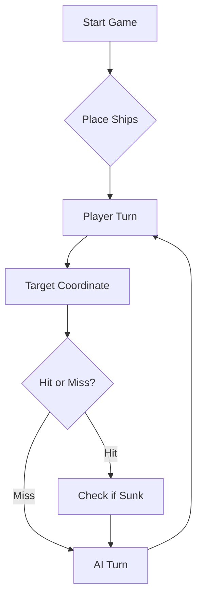

# ⚓ Battleship 2.0


## GrupoTP05_LEI-1

### Membros

| Curso | Número | Nome |
| :--- | :--- | :--- |
| LEI | 101283 | André Durães |
| LEI | 113044 | Simão Espanha |
| LEI | 123572 | Nelssy Pina |
| LEI | 129329 | Luís de Sousa |

Obs.: O Membro Simão Espanha tem duas contas diferentes com contribuições neste projeto: O User @ssespa99 e o User @LEI-113044.


---
> A modern take on the classic naval warfare game, designed for the XVII century setting with updated software engineering patterns.
## 📖 Table of Contents
- [Project Overview](#-project-overview)
- [Key Features](#-key-features)
- [Technical Stack](#-technical-stack)
- [Installation & Setup](#-installation--setup)
- [Code Architecture](#-code-architecture)
- [Roadmap](#-roadmap)
- [Contributing](#-contributing)

---

## 🎯 Project Overview
This project serves as a template and reference for students learning **Object-Oriented Programming (OOP)** and **Software Quality**. It simulates a battleship environment where players must strategically place ships and sink the enemy fleet.

### 🎮 The Rules
The game is played on a grid (typically 10x10). The coordinate system is defined as:

$$(x, y) \in \{0, \dots, 9\} \times \{0, \dots, 9\}$$

Hits are calculated based on the intersection of the shot vector and the ship's bounding box.

---

## ✨ Key Features
| Feature | Description | Status |
| :--- | :--- | :---: |
| **Grid System** | Flexible $N \times N$ board generation. | ✅ |
| **Ship Varieties** | Galleons, Frigates, and Brigantines (XVII Century theme). | ✅ |
| **AI Opponent** | Heuristic-based targeting system. | 🚧 |
| **Network Play** | Socket-based multiplayer. | ❌ |

---

## 🛠 Technical Stack
* **Language:** Java 17
* **Build Tool:** Maven / Gradle
* **Testing:** JUnit 5
* **Logging:** Log4j2

---

## 🚀 Installation & Setup

### Prerequisites
* JDK 17 or higher
* Git

### Step-by-Step
1. **Clone the repository:**
   ```bash
   git clone [https://github.com/britoeabreu/Battleship2.git](https://github.com/britoeabreu/Battleship2.git)
   ```
2. **Navigate to directory:**
   ```bash
   cd Battleship2
   ```
3. **Compile and Run:**
   ```bash
   javac Main.java && java Main
   ```

---

## 📚 Documentation

You can access the generated Javadoc here:

👉 [Battleship2 API Documentation](https://britoeabreu.github.io/Battleship2/)


### Core Logic
```java
public class Ship {
    private String name;
    private int size;
    private boolean isSunk;

    // TODO: Implement damage logic
    public void hit() {
        // Implementation here
    }
}
```

### Design Patterns Used:
- **Strategy Pattern:** For different AI difficulty levels.
- **Observer Pattern:** To update the UI when a ship is hit.
</details>

### Logic Flow


---

## 🗺 Roadmap
- [x] Basic grid implementation
- [x] Ship placement validation
- [ ] Add sound effects (SFX)
- [ ] Implement "Fog of War" mechanic
- [ ] **Multiplayer Integration** (High Priority)

---

## 🧪 Testing
We use high-coverage unit testing to ensure game stability. Run tests using:
```bash
mvn test
```

> [!TIP]
> Use the `-Dtest=ClassName` flag to run specific test suites during development.

---

## 🤝 Contributing
Contributions are what make the open-source community such an amazing place to learn, inspire, and create.

1. Fork the Project
2. Create your Feature Branch (`git checkout -b feature/AmazingFeature`)
3. Commit your Changes (`git commit -m 'Add some AmazingFeature'`)
4. Push to the Branch (`git push origin feature/AmazingFeature`)
5. Open a **Pull Request**

---

## 📄 License
Distributed under the MIT License. See `LICENSE` for more information.

---
**Maintained by:** [@britoeabreu](https://github.com/britoeabreu)  
*Created for the Software Engineering students at ISCTE-IUL.*

# Prompt LLM para jogar melhor

Considere agora a seguinte tática de geração de rajadas de tiros.

## 📓 1. Diário de Bordo
Manter um registo sequencial (Rajada 1, 2, 3...) com:

Coordenadas exatas de cada tiro

Respetivo resultado (Água, Nau atingida, Barca afundada, etc.)

"A memória é a principal arma de um bom estratega."

## 🎯 2. Regras de Tiro
Nunca disparar fora dos limites do mapa (A–J, 1–10).

Nunca repetir coordenadas já testadas.

Exceção: na última rajada do jogo, é permitido repetir tiros apenas para perfazer os 3 tiros obrigatórios, quando a frota inimiga já estiver irremediavelmente afundada.

## ♟️ 3. Abertura em Padrão Xadrez
Disparar apenas em casas onde (linha + coluna) é par — ex.: B2, D4, F6, H8, J10.

Garante que qualquer navio de comprimento ≥ 2 é detetado com metade dos tiros.

Cobre o tabuleiro 10x10 em ~50 tiros em vez de 100, maximizando a eficiência.

Escolher tiros bem espaçados entre si (cantos + centro) para diversificar a informação recolhida.

## 🔥 4. Após Acerto — Caça Direcionada
Disparar nas posições contíguas pela ordem fixa: Norte → Sul → Este → Oeste, para descobrir a orientação da embarcação.

Assim que 2 acertos consecutivos revelarem a orientação (horizontal/vertical), varrer nessa direção até afundar.

Se a rajada anterior confirmar que o navio já foi afundado, parar de disparar para as contíguas — os navios nunca estão encostados.

## 🚫 5. Evitar Diagonais de Acertos
Caravelas, Naus e Fragatas são linhas retas: um tiro certeiro significa que o resto do navio está na horizontal ou vertical.

Como os navios não se tocam (nem nos cantos), as posições diagonais a um tiro certeiro são garantidamente água.

Única exceção: o corpo do Galeão (forma em T). Ter em mente ao evitar diagonais.

## ⭕ 6. Halo Obrigatório Após Afundar
Quando o relatório confirmar um navio afundado (ex.: Fragata de 4 posições), analisar o Diário de Bordo para identificar exatamente onde caíram esses tiros.

Confirmada a posição exata da carcaça, marcar todas as quadrículas adjacentes (halo de 1 posição em redor do navio) como água intransitável.

É impossível haver outra embarcação nesse perímetro.

## 🧭 7. Priorização de Zonas
Dar prioridade a zonas com mais espaço livre para barcos grandes (Fragata, Galeão).

Evitar concentrar tiros em áreas já muito testadas.
