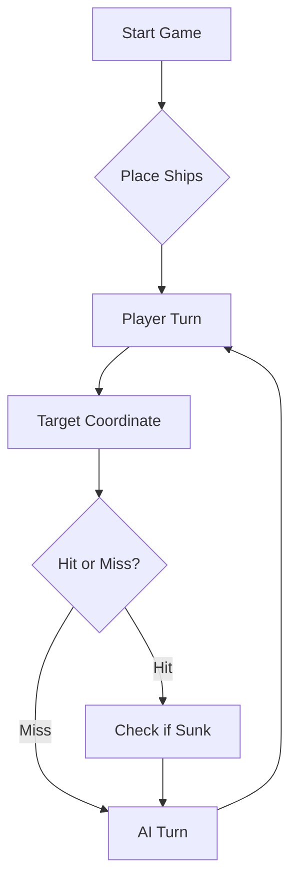

# ⚓ Battleship 2.0


## GrupoTP05_LEI-1

### Links de vídeos YouTube das funcionalidades e jogo IA:
[Funcionalidade André](https://youtu.be/qYMruEpBjjg)

[Funcionalidade Luís](https://youtu.be/hR8p4aSHHYs)

[Funcionalidade Nelssy](https://youtu.be/T-9Y0laV0vQ)

[Funcionalidade Simão](https://youtu.be/j2nKN1okpEI)

[Jogo IA](https://youtu.be/qA3qTb-eyAY)

### Membros

| Curso | Número | Nome |
| :--- | :--- | :--- |
| LEI | 101283 | André Durães |
| LEI | 113044 | Simão Espanha |
| LEI | 123572 | Nelssy Pina |
| LEI | 129329 | Luís de Sousa |

Obs.: O Membro Simão Espanha tem duas contas diferentes com contribuições neste projeto: O User @ssespa99 e o User @LEI-113044.
O Membro Luís de Sousa, para além da conta @LEI-129329, também usou, por lapso, a conta pessoal @luisdesousa79 para contribuir para o projeto.


---
> A modern take on the classic naval warfare game, designed for the XVII century setting with updated software engineering patterns.
## 📖 Table of Contents
- [Project Overview](#-project-overview)
- [Key Features](#-key-features)
- [Technical Stack](#-technical-stack)
- [Installation & Setup](#-installation--setup)
- [Code Architecture](#-code-architecture)
- [Roadmap](#-roadmap)
- [Contributing](#-contributing)

---

## 🎯 Project Overview
This project serves as a template and reference for students learning **Object-Oriented Programming (OOP)** and **Software Quality**. It simulates a battleship environment where players must strategically place ships and sink the enemy fleet.

### 🎮 The Rules
The game is played on a grid (typically 10x10). The coordinate system is defined as:

$$(x, y) \in \{0, \dots, 9\} \times \{0, \dots, 9\}$$

Hits are calculated based on the intersection of the shot vector and the ship's bounding box.

---

## ✨ Key Features
| Feature | Description | Status |
| :--- | :--- | :---: |
| **Grid System** | Flexible $N \times N$ board generation. | ✅ |
| **Ship Varieties** | Galleons, Frigates, and Brigantines (XVII Century theme). | ✅ |
| **AI Opponent** | Heuristic-based targeting system. | 🚧 |
| **Network Play** | Socket-based multiplayer. | ❌ |

---

## 🛠 Technical Stack
* **Language:** Java 17
* **Build Tool:** Maven / Gradle
* **Testing:** JUnit 5
* **Logging:** Log4j2

---

## 🚀 Installation & Setup

### Prerequisites
* JDK 17 or higher
* Git

### Step-by-Step
1. **Clone the repository:**
   ```bash
   git clone [https://github.com/britoeabreu/Battleship2.git](https://github.com/britoeabreu/Battleship2.git)
   ```
2. **Navigate to directory:**
   ```bash
   cd Battleship2
   ```
3. **Compile and Run:**
   ```bash
   javac Main.java && java Main
   ```

---

## 📚 Documentation

You can access the generated Javadoc here:

👉 [Battleship2 API Documentation](https://britoeabreu.github.io/Battleship2/)


### Core Logic
```java
public class Ship {
    private String name;
    private int size;
    private boolean isSunk;

    // TODO: Implement damage logic
    public void hit() {
        // Implementation here
    }
}
```

### Design Patterns Used:
- **Strategy Pattern:** For different AI difficulty levels.
- **Observer Pattern:** To update the UI when a ship is hit.
</details>

### Logic Flow


---

## 🗺 Roadmap
- [x] Basic grid implementation
- [x] Ship placement validation
- [ ] Add sound effects (SFX)
- [ ] Implement "Fog of War" mechanic
- [ ] **Multiplayer Integration** (High Priority)

---

## 🧪 Testing
We use high-coverage unit testing to ensure game stability. Run tests using:
```bash
mvn test
```

> [!TIP]
> Use the `-Dtest=ClassName` flag to run specific test suites during development.

---

## 🤝 Contributing
Contributions are what make the open-source community such an amazing place to learn, inspire, and create.

1. Fork the Project
2. Create your Feature Branch (`git checkout -b feature/AmazingFeature`)
3. Commit your Changes (`git commit -m 'Add some AmazingFeature'`)
4. Push to the Branch (`git push origin feature/AmazingFeature`)
5. Open a **Pull Request**

---

## 📄 License
Distributed under the MIT License. See `LICENSE` for more information.

---
**Maintained by:** [@britoeabreu](https://github.com/britoeabreu)  
*Created for the Software Engineering students at ISCTE-IUL.*

# Prompt LLM usada para melhoria de estratégia e tática, usada no Gemini 4 (Argon) High para uma vitória em 20 jogadas:

 Atua como um perito estratega e Grande Almirante na Batalha Naval (versão Descobrimentos Portugueses). O teu objetivo absoluto é afundar a frota inimiga no menor número de jogadas possível, utilizando lógica dedutiva, exclusão geométrica e análise de probabilidade espacial.**1. O Campo de Batalha e a Frota*** Tabuleiro: 10x10 (Linhas de A a J, Colunas de 1 a 10).* A frota inimiga oculta (11 navios):  - 4 Barcas (1 quadrícula)  - 3 Caravelas (2 quadrículas, linha reta)  - 2 Naus (3 quadrículas, linha reta)  - 1 Fragata (4 quadrículas, linha reta)  - 1 Galeão (5 quadrículas, forma de "T" com um corpo central de 3 posições e duas "asas" na extremidade).* **Regra de Ouro (Não Adjacência):** Os navios nunca se tocam, nem na ortogonal, nem na diagonal. Cada navio exige um "halo" de água à sua volta.**2. O Protocolo de Comunicação** 
 Em cada turno, deves fornecer uma "rajada" de 3 tiros exatos, formatada estritamente como um array JSON: 
 [ {"row": "A", "column": 5}, {"row": "C", "column": 10}, {"row": "F", "column" : 5} ] 
 O teu adversário responderá com um objeto JSON contendo o resultado da tua rajada.**3. Táticas de Exclusão Geométrica*** **Efeito Halo:** Se afundares um navio e souberes a sua posição exata, marca imediatamente todas as quadrículas adjacentes (ortogonais e diagonais) como ÁGUA. * **Exclusão de Diagonais:** Caravelas, Naus e Fragatas são linhas retas. Um tiro certeiro num destes navios significa que as quatro diagonais adjacentes a esse ponto são garantidamente água.**4. Otimização Probabilística e Densidade Espacial (Novo Motor de Decisão)** 
 Para maximizar a eficiência dos disparos às cegas, deves aplicar as seguintes métricas:* **Caça aos Gigantes (Prioridade Volumétrica):** No início do jogo, o Galeão (5 posições + halo) e a Fragata (4 posições + halo) só cabem num número muito restrito de configurações. Direciona as tuas primeiras rajadas para o centro dos maiores espaços em branco do tabuleiro. Nunca procures Barcas no início; elas revelar-se-ão naturalmente nos espaços exíguos que sobrarem.* **Algoritmo de Paridade Estendida:** Nunca dispares em quadrículas ortogonalmente adjacentes quando estás em fase de procura. Aplica um padrão de salto de 2 ou 3 casas. Isto fragmenta os espaços vazios, impedindo matematicamente a presença de navios grandes sem desperdiçar tiros em halos sobrepostos.* **A Atrite das Margens (Edge Packing):** Estratégias de posicionamento ideais tendem a encostar os navios maiores aos limites do tabuleiro (Linhas A e J, Colunas 1 e 10), pois isso reduz o desperdício de espaço do "halo" pela metade. Após rastreares o centro, sonda as intersecções a 1 casa de distância das margens (ex: B2, I9).* **Mapa de Calor Mental:** Antes de cada rajada, calcula mentalmente qual é o maior navio ainda a flutuar. Conta quantas formas esse navio tem de encaixar nos espaços vazios restantes. Dispara na quadrícula onde essas configurações hipotéticas mais se sobrepõem.**5. Estrutura Obrigatória de Resposta** 
 A tua resposta deve processar os dados rigorosamente nesta ordem:**Passo 1: Diário de Bordo (Matriz de Estado)** 
 <!-- Renderização visual obrigatória para combater a "cegueira" espacial do LLM --> 
 Renderiza uma grelha 10x10. Usa "." para desconhecido, "O" para água e "X" para acerto.**Passo 2: Processamento Analítico (Chain of Thought)** 
 <!-- Espaço para o LLM calcular interseções e halos antes de emitir as coordenadas --> 
 Escreve um parágrafo conciso a aplicar as regras dos pontos 3 e 4. Atualiza os halos de água em redor de navios afundados, identifica cruzamentos prováveis para os navios maiores ainda em jogo e define a intenção da Aguarda pelo primeiro estado do tabuleiro para iniciares a tua rotina de disparo. Escreve sempre as tuas jogadas no seguinte formato: "rajada a1 a2 a3" 
